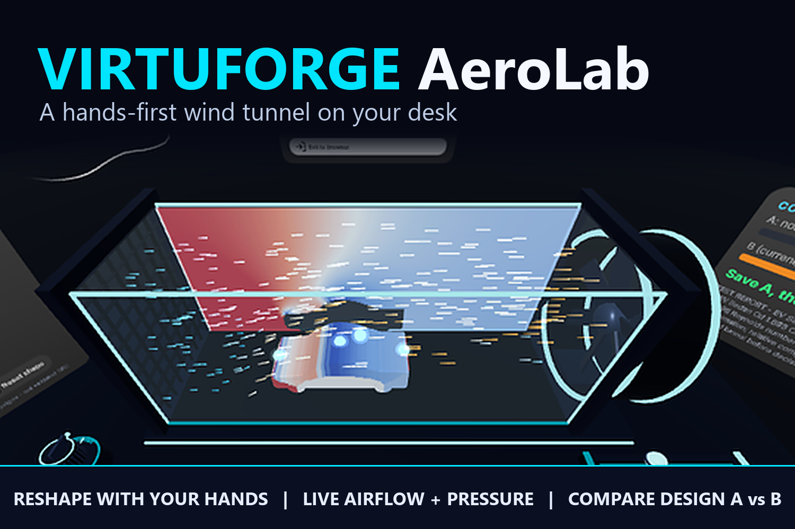

# VIRTUFORGE: AeroLab

**A hands-first wind tunnel on your desk.** Reshape cars, planes and wings with your fingers, watch live airflow and pressure respond, and compare design A against design B in seconds.

AeroLab is the first module of VIRTUFORGE, a virtual space where engineers and designers test product ideas before paying for physical prototypes. It runs in the browser on Meta Quest and Meta VR Glasses (WebXR), and needs no controllers.

**Try it:** https://abc-001-f.github.io/virtuforge/. Open it in the Quest Browser or on Meta VR Glasses and press **Enter XR**. No headset? Run it locally with `npm run dev` (see below), which includes Meta's Quest emulator, or install the [Immersive Web Emulator](https://chromewebstore.google.com/detail/immersive-web-emulator/cgffilbpcibhmcfbgggfhfolhkfbhmik) Chrome extension and open the live link.



## What you can do

| With your hands | What happens |
|---|---|
| Pinch a model button | Load an EV sedan, sports car, delivery van, airplane, drone, NACA 2412 wing, or an imported glTF toy car |
| Pinch the lever and slide | Wind speed from 20 to 200 km/h |
| Pinch the knob and lift or lower your hand | Tilt the model nose up or down (angle of attack, -15 to +20 deg) |
| Pinch a glowing handle on the car and drag | Change the nose, roof height, roof position or tail. The airflow re-forms around the new shape within seconds |
| **Save A**, change something, read the results panel | "B has 12% less drag than A", plus a test report with the conditions and limitations |
| **View / Skin / Explode** | Smoke streaks, a speed or pressure map on the tunnel wall, a pressure-coloured skin on the model, and an exploded view of the car's battery, motor and wheels |

It is built for **seated use within arm's reach**: no walking, no controllers, and a full design-and-compare loop in under 10 minutes. On Meta VR Glasses, gaze picks the target and a pinch confirms. On Quest, the hand ray aims and a pinch confirms.

## How it works

```
 model (procedural or glTF)
        │  side silhouette rasterised onto a 240 x 96 grid
        ▼
 Web Worker: D2Q9 lattice-Boltzmann solver (BGK + Smagorinsky)
        │  velocity, density, drag and lift via momentum exchange, ~10 frames/s
        ▼
 smoke streaks · speed/pressure field · pressure skin · Cd / Cl readouts · A vs B
```

- **Real fluid physics, live.** A 2D lattice-Boltzmann solver runs in a Web Worker so the headset never stutters. Drag and lift come from the momentum the air transfers to the model, measured against still air and time-averaged.
- **Any model can go in the tunnel.** Every triangle of the model is projected into the tunnel's plane and rasterised into the solver grid, so imported glTF models work the same way as the built-in ones.
- **The shape you see is the shape the physics sees.** The parametric car body is extruded from the same 2D profile that the solver simulates, so dragging a handle changes both at once.

Built with the [Immersive Web SDK](https://iwsdk.dev) (Three.js + ECS), TypeScript and Vite.

## Honest limits

AeroLab is for **comparing design ideas and learning how air behaves**, not for certifying a design:

- It is a **2D centreline slice**, not full 3D flow. Absolute numbers (for example Cd ≈ 1.6 for the sedan) are higher than real 3D cars. The **relative** comparison between A and B is the meaningful result.
- The grid is coarse (240 x 96), the Reynolds number is low (a few hundred), and the tunnel walls are close to the model.
- Validate any real decision with 3D CFD (for example OpenFOAM) or a physical wind tunnel. The in-app report says the same.

## Run it locally

Requires Node.js 20.19+ (or 22.12+).

```sh
npm install
npm run dev        # opens the app with the Quest emulator
npm run typecheck
npm run build      # production build in dist/
```

Every push to `master` is built and published to GitHub Pages by `.github/workflows/deploy.yml`.

## Project layout

```
src/aero/lbm.ts            lattice-Boltzmann solver
src/aero/lbm.worker.ts     solver worker + drag/lift averaging
src/aero/silhouette.ts     model -> solver grid rasteriser, model fitting
src/aero/flow-viz.ts       smoke streaks, speed/pressure fields
src/aero/pressure-skin.ts  pressure-coloured model shader
src/aero/models/           parametric car, airplane, drone, NACA 2412 wing
src/wind-tunnel.ts         ties the model, solver and visuals together
src/controls.ts            lever, tilt knob, shape handles
src/ui.ts                  panels, A/B comparison, test report
public/scenes/             lab scene
public/ui/                 panel layouts (UIKitML)
```

## Roadmap

- **Validated physics:** send a design to OpenFOAM for a full 3D CFD run and show the results in the same tunnel.
- **Shared sessions:** an engineer and a designer reshape the same model together and review constraints live.
- **More VIRTUFORGE labs:** StressLab (forces and deformation), ThermalLab (heat and cooling), AssemblyLab (factory layouts and robot reach).
- **Bring your own CAD:** drop in a glTF of your own product.

## Credits

- **ToyCar** model by Guido Odendahl and Eric Chadwick, [CC0 1.0](https://creativecommons.org/publicdomain/zero/1.0/), from the [Khronos glTF Sample Assets](https://github.com/KhronosGroup/glTF-Sample-Assets/tree/main/Models/ToyCar).
- All other models, the lab and the tunnel are generated in code for this project.
